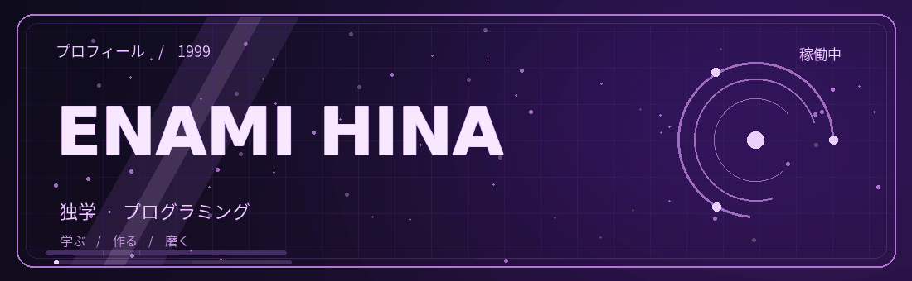
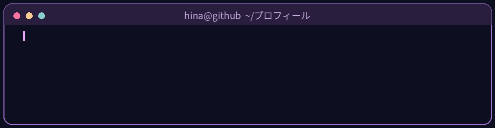

<!-- Enami Hina · GitHubプロフィール · 1999 -->

<h2>Enami Hina</h2>

<code>1999年生まれ</code>

### ✦ 技術スタック

**言語**

`HTML` · `CSS` · `JavaScript` · `SQL` · `PowerShell`

**ツール・プラットフォーム**

`Node.js` · `Git` · `GitHub` · `VS Code` · `Supabase` · `Vercel`

**関心分野**

`Web UI` · `アニメーション` · `PWA` · `REST API` · `地図` 

### ✦ ターミナル

### ✦ 学びのサイクル

[**GitHub · junex0x**](https://github.com/junex0x)

Enami Hina © 2026

